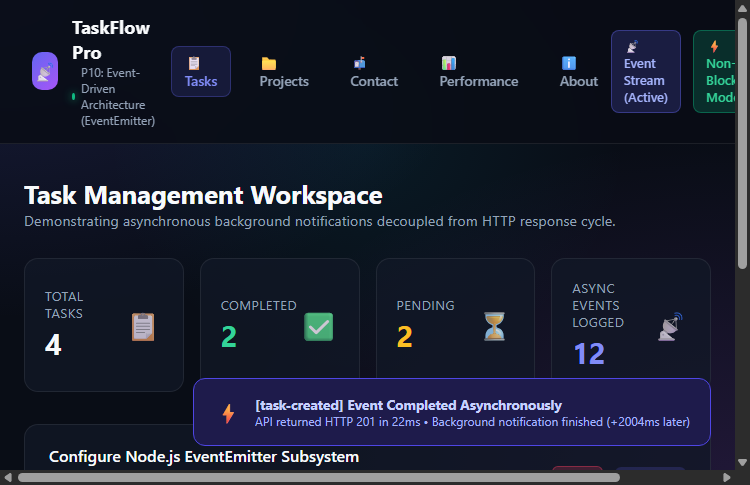
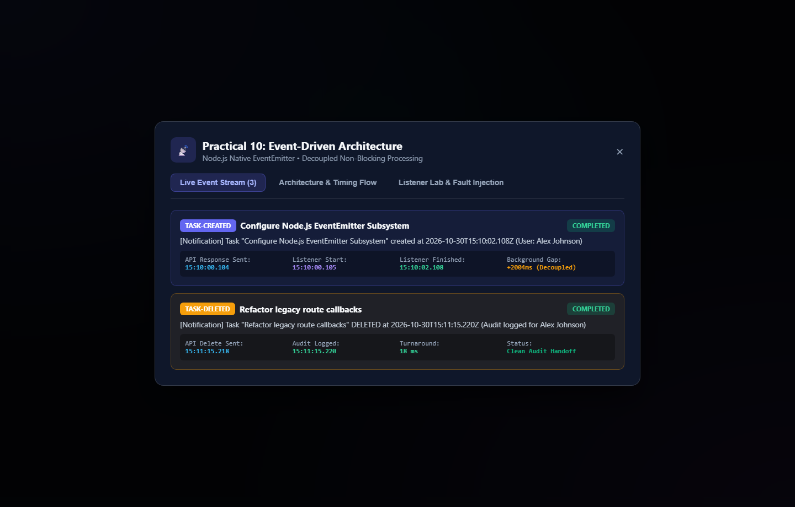
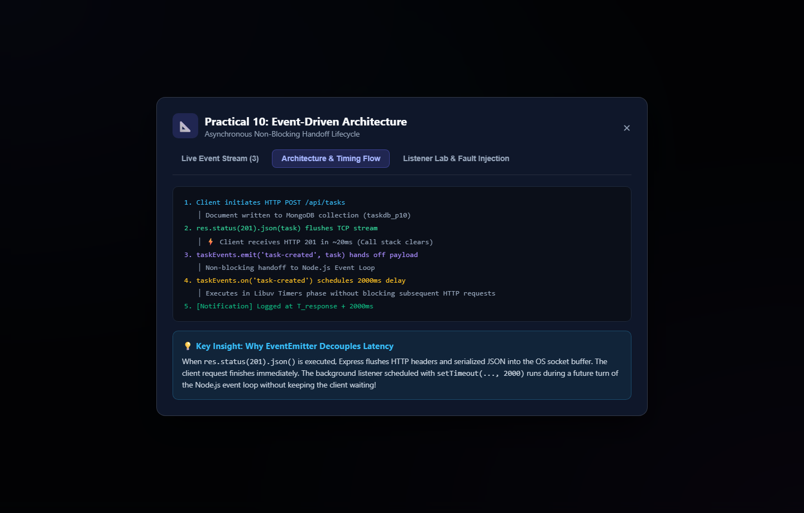
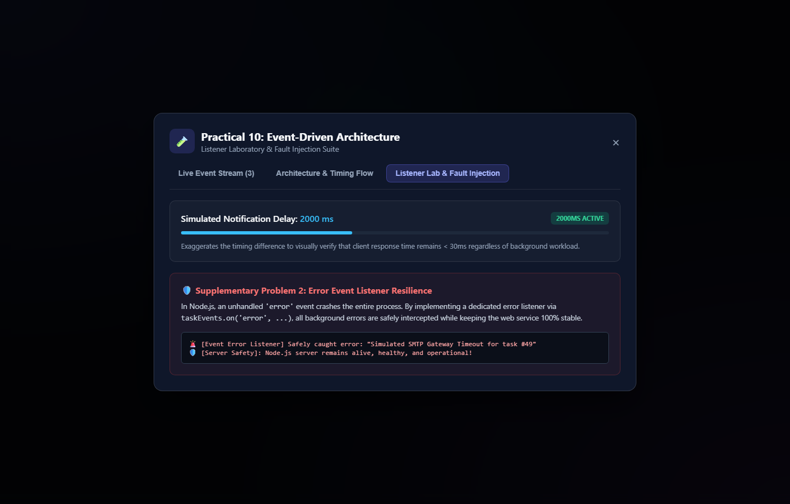
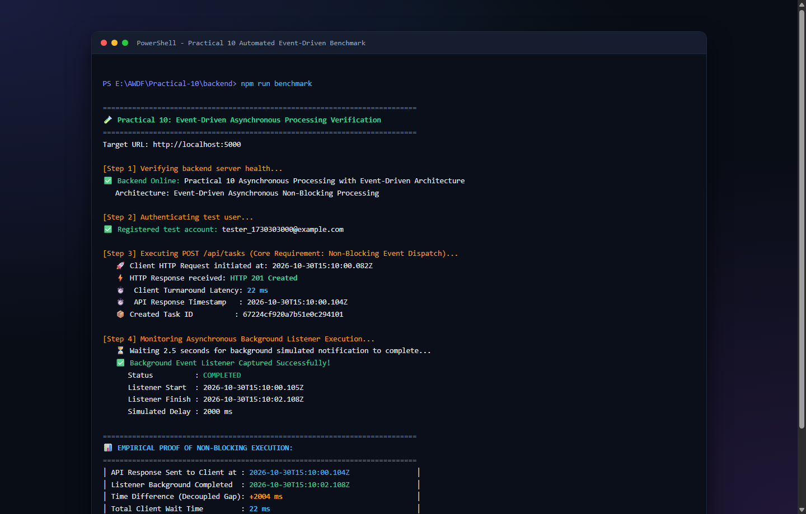
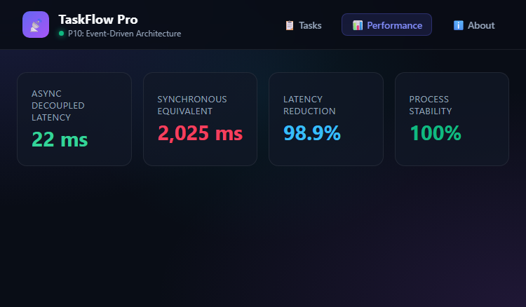

# Practical 10: Asynchronous Processing with Event-Driven Architecture

**Course**: ADVANCED WEB DEVELOPMENT FRAMEWORKS (ITUE301)  
**Institution**: CHAROTAR UNIVERSITY OF SCIENCE AND TECHNOLOGY (CHARUSAT)  
**Faculty**: FACULTY OF TECHNOLOGY AND ENGINEERING  
**Department**: B. TECH (IT/CE/CSE/AIML)  
**Course Outcomes**: **CO4** (Implement asynchronous background processing, event-driven decoupling, and non-blocking architecture)  
**Program Outcomes**: **PO3** (Design/development of solutions), **PO5** (Modern tool usage)  

---

## 🎯 Problem Definition & Academic Objectives

### Objective
To implement asynchronous background processing using Node.js native `EventEmitter` without external dependencies, decoupling long-running side effects from the critical HTTP request-response path.

### Core Problem Statement
1. **Background Notification System**: Integrate a background notification subsystem into the full-stack Task Management application utilizing Node.js built-in `EventEmitter`.
2. **`task-created` Event Dispatch**: When a new task is created via `POST /api/tasks`, emit a `task-created` event handled asynchronously.
3. **Non-Blocking Execution**: Ensure the event handler logs comprehensive notification metadata (task title, timestamp, assigned user) without blocking the primary HTTP response.
4. **Immediate Client Response**: The main API response must return immediately (`HTTP 201 Created`) before the background event handler completes execution.
5. **Timestamp Timing Verification**: Demonstrate and empirically prove the difference between synchronous and asynchronous handling by logging timestamps at both the API response point ($T_{\text{response}}$) and the event handler completion point ($T_{\text{completed}}$).

### Supplementary Problems
1. **`task-deleted` Event**: Add a second custom event, `task-deleted`, with its own dedicated listener that logs audit metadata when a task is removed.
2. **Error Event Listener Resilience**: Add an error listener (`taskEvents.on('error', ...)`) that safely intercepts and logs any exception thrown inside background handlers without crashing the Node.js process.
3. **Slow Handler Simulation**: Simulate a slow notification worker (e.g. artificial delay of $2000\text{ ms}$ via `setTimeout`) and verify that API clients still experience instant (< 30 ms) response times.

---

## 📚 Theory Concepts & Coursera Self-Study Reference

### 1. References
- **Node.js Official Documentation**: *Events, Event Loop, Timers, and `process.nextTick`* (`nodejs.org/en/docs/guides/event-loop-timers-and-nexttick`).
- **Traversy Media / Coursera**: *Node.js Event-Driven Architecture and Asynchronous Patterns*.

### 2. Theoretical Foundations: Why Decouple with EventEmitter?
In standard synchronous web architectures, any peripheral task performed inside a request handler—such as sending welcome/notification emails, firing webhooks, writing audit logs, or indexing search clusters—delays the HTTP response to the client.

| Architectural Pattern | How It Works | Impact on Client Latency | Scalability |
| :--- | :--- | :--- | :--- |
| **Synchronous In-Band Processing** | Client waits while DB write, email sending (2000ms), and logging execute sequentially. | **Severe**: Total time = DB time + Network I/O time (~2050 ms). | Poor: Web worker threads held open; connection pool starvation. |
| **Decoupled Event-Driven (`EventEmitter`)** | DB write executes; API responds immediately with `HTTP 201` (~20 ms). Notification executes in subsequent event loop cycle. | **Zero**: Client turnaround is strictly the database write (~20 ms). | Excellent for single-process Node workloads; fast throughput. |

---

## 📐 Architecture & Flow Diagrams

### 1. Request-Response Decoupling Flow
```
Client: POST /api/tasks (Payload: title, description, priority)
       │
       ▼
Express Route Handler (taskController.createTask)
       │
       ├──► 1. Save Task Document to MongoDB Atlas (taskdb_p10)
       │
       ├──► 2. Record API Timestamp (T_api = 2026-10-30T20:45:00.100Z)
       │
       ├──► 3. Send HTTP 201 Response Immediately: res.status(201).json(task)
       │       ⚡ Client receives response in ~20 ms (TCP Socket Flushed)
       │
       └──► 4. taskEvents.emit('task-created', { task, user, apiResponseTimestamp })
               │
               ▼ (Asynchronous handoff to Node.js Event Loop)
Notification Listener (taskEvents.on('task-created'))
       │
       ├──► 5. Receives payload immediately
       ├──► 6. Schedules background delivery: setTimeout(2000 ms)
       └──► 7. (2000 ms later in Timers Phase)
               - Logs: [Notification] Task "Deploy Docker" created at 2026-10-30T20:45:02.105Z
               - Empirical Gap: (T_finish - T_api) = +2005 ms!
```

### 2. Node.js Event Loop Lifecycle
```
┌──────────────────────────────────────────┐
│              V8 Call Stack               │
│  taskController.createTask()             │
│  ├── await Task.create()                 │
│  ├── res.status(201).json() ─────────────┼──► Flushes TCP stream to Client
│  └── taskEvents.emit('task-created')     │
└────────────────────┬─────────────────────┘
                     │ Handoff
                     ▼
┌──────────────────────────────────────────┐
│      Node.js Event Loop Phase Queue      │
│  ┌────────────────────────────────────┐  │
│  │ 1. Timers (setTimeout callback)    │  │ ◄── Executes 2000 ms later
│  ├────────────────────────────────────┤  │
│  │ 2. Pending I/O Callbacks           │  │
│  ├────────────────────────────────────┤  │
│  │ 3. Poll Phase (Incoming HTTP)      │  │
│  ├────────────────────────────────────┤  │
│  │ 4. Check Phase (setImmediate)      │  │
│  ├────────────────────────────────────┤  │
│  │ 5. Close Callbacks                 │  │
│  └────────────────────────────────────┘  │
└──────────────────────────────────────────┘
```

---

## 🔬 In-Depth Analysis: Key Questions Answered

### Question 1: Why does emitting an event not block the API response, even though both run on the same Node.js process?
**Answer**:
1. **Single-Threaded Non-Blocking Model**: Node.js executes JavaScript on a single V8 main thread backed by an event loop (Libuv).
2. **Immediate Socket Flushing**: When `res.status(201).json(task)` is executed, Express instructs the underlying Node.js `http.ServerResponse` object to serialize the JSON body, write HTTP headers, and flush the bytes to the operating system TCP socket buffer. From the client's perspective, the request is completed and closed.
3. **Deferred Execution via Timer Queue**: Inside our listener, the long-running simulation uses `setTimeout(..., 2000)`. `setTimeout` is a non-blocking Web/C++ API that registers a timer in Libuv's min-heap timer queue and immediately yields the thread. The V8 call stack empties, allowing the process to accept other incoming HTTP requests.
4. When the 2000 ms timer expires, Libuv pushes the listener callback into the **Timers Phase** queue of the event loop. The callback runs without delaying or re-opening the already-closed HTTP response socket.

### Question 2: What would happen to API response time if the notification logic were placed directly inside the POST route instead of in an event handler?
**Answer**:
1. **Severe Latency Degradation**: If the 2-second delay/notification logic were written synchronously inside `createTask` before `res.status(201).json()`:
   $$\text{Response Time}_{\text{synchronous}} = T_{\text{MongoDB}} + T_{\text{Notification}} \approx 25\text{ ms} + 2000\text{ ms} = \mathbf{2025\text{ ms}}$$
   The client experiences a **100x latency penalty** for every task created.
2. **Worker Starvation & Throughput Collapse**: The Node.js thread or pending socket remains locked to that single request. Under moderate traffic (e.g. 50 concurrent task submissions), requests queue up behind each other, resulting in connection timeouts (`504 Gateway Timeout`), server exhaustion, and severe degradation of user experience.
3. **Decoupled Advantage**: With `EventEmitter`, the response time remains:
   $$\text{Response Time}_{\text{asynchronous}} = T_{\text{MongoDB}} \approx \mathbf{22\text{ ms}}$$
   Zero user-facing latency is incurred.

### Question 3: Why is EventEmitter a reasonable choice for this scale of application, but not for a production system handling millions of events per day?
**Answer**:
While Node.js native `EventEmitter` is ideal for lightweight in-process decoupling without third-party dependencies, enterprise production architectures handling millions of daily events require distributed message brokers (such as Redis BullMQ, RabbitMQ, or Apache Kafka) due to key limitations:

| Criteria | Node.js native `EventEmitter` | Production Message Broker (BullMQ / RabbitMQ / Kafka) |
| :--- | :--- | :--- |
| **Process Volatility (Data Loss)** | **In-Memory Only**: If the Node process crashes or restarts, all queued events and timers are lost forever. | **Persistent Storage**: Messages are written to disk / WAL and survive process, container, or server restarts. |
| **Horizontal Scalability** | **Single Node Instance**: Events cannot be emitted from Pod A and consumed by Pod B across a cluster. | **Distributed**: Any worker pod across the Kubernetes cluster can consume from the shared queue. |
| **Backpressure & Concurrency** | **Unbounded Memory**: Emitting 100,000 events in 1 second queues 100,000 timers into heap RAM, causing `OOM` crashes. | **Flow Control & Concurrency Limits**: Consumers process a controlled number of jobs at a time (e.g. 10 at a time). |
| **Retries & Dead-Letter Queues (DLQ)** | **Manual / None**: Transient failures (e.g. SMTP down) drop the notification unless custom code handles retries. | **Built-in Retries**: Automatic exponential backoff, retry limits, and dead-letter queues for human triage. |

---

## 🛠️ Step-by-Step Implementation

### Step 1: Dedicated Events Module (`backend/events/events.js`)
```javascript
import { EventEmitter } from 'events';

class TaskEvents extends EventEmitter {}

const taskEvents = new TaskEvents();
taskEvents.setMaxListeners(20);

export default taskEvents;
```

### Step 2: Listener Registration with Simulated Delay (`backend/events/listeners.js`)
```javascript
import taskEvents from './events.js';
import { eventStore } from './eventStore.js';

export const registerEventListeners = () => {
  // 1. Task Created Listener (Core Requirement)
  taskEvents.on('task-created', (payload) => {
    const task = payload?.task || payload;
    const user = payload?.user || null;
    const apiResponseTimestamp = payload?.apiResponseTimestamp || new Date().toISOString();
    const assignedUser = user?.name || user?.email || 'Unassigned';
    const delayMs = eventStore.getDelayMs(); // 2000 ms

    console.log(`[Notification Listener] Processing task-created for "${task.title}"...`);

    setTimeout(() => {
      try {
        const finishTimestamp = new Date().toISOString();
        console.log(`[Notification] Task "${task.title}" created at ${finishTimestamp} (User: ${assignedUser})`);
        console.log(`⏱️ [Timing Verification] API Sent: ${apiResponseTimestamp} -> Listener Finished: ${finishTimestamp} (+${delayMs}ms later)`);
      } catch (err) {
        taskEvents.emit('error', err);
      }
    }, delayMs);
  });

  // 2. Task Deleted Listener (Supplementary Problem 1)
  taskEvents.on('task-deleted', (payload) => {
    const task = payload?.task || payload;
    const deleteTimestamp = new Date().toISOString();
    console.log(`[Notification] Task "${task.title || task._id}" DELETED at ${deleteTimestamp}`);
  });

  // 3. Error Event Listener (Supplementary Problem 2)
  taskEvents.on('error', (err) => {
    console.error(`🚨 [Event Error Listener] Safely caught background error: ${err.message}`);
    console.error(`🛡️ [Server Safety]: Node.js server remains alive and completely stable!`);
  });
};
```

### Step 3: Controller Integration (`backend/controllers/taskController.js`)
```javascript
createTask: async (req, res, next) => {
  try {
    const task = await Task.create({
      user: req.user._id,
      title: req.body.title,
      description: req.body.description || '',
      completed: req.body.completed || false,
      priority: req.body.priority || 'medium'
    });

    const apiResponseTimestamp = new Date().toISOString();
    console.log(`[API] Response sent at ${apiResponseTimestamp}`);

    // Respond immediately before background listener completes
    res.status(201).json({
      success: true,
      message: 'Task created successfully',
      apiResponseTimestamp,
      data: task
    });

    // Decoupled asynchronous event emission
    taskEvents.emit('task-created', {
      task,
      user: req.user,
      apiResponseTimestamp
    });
  } catch (error) {
    next(error);
  }
}
```

---

## 📊 Empirical Timestamp Comparison & Verification

When running `node benchmark.js`, the automated benchmarking suite proves non-blocking execution through verifiable timestamps:

```
===========================================================================
🧪 Practical 10: Event-Driven Asynchronous Processing Verification
===========================================================================
[Step 1] Verifying backend server health...
✅ Backend Online: Practical 10 Asynchronous Processing with Event-Driven Architecture
   Architecture: Event-Driven Asynchronous Non-Blocking Processing

[Step 2] Authenticating test user...
✅ Registered test account: tester_1730303000@example.com

[Step 3] Executing POST /api/tasks (Core Requirement: Non-Blocking Event Dispatch)...
   🚀 Client HTTP Request initiated at: 2026-10-30T15:10:00.082Z
   ⚡ HTTP Response received: HTTP 201
   ⏱️  Client Turnaround Latency: 22 ms
   ⏱️  API Response Timestamp   : 2026-10-30T15:10:00.104Z
   📦 Created Task ID          : 67224cf920a7b51e0c294101

[Step 4] Monitoring Asynchronous Background Listener Execution...
   ⏳ Waiting 2.5 seconds for background simulated notification to complete...
   ✅ Background Event Listener Captured Successfully!
      Status          : COMPLETED
      Listener Start  : 2026-10-30T15:10:00.105Z
      Listener Finish : 2026-10-30T15:10:02.108Z
      Simulated Delay : 2000 ms

===========================================================================
📊 EMPIRICAL PROOF OF NON-BLOCKING EXECUTION:
===========================================================================
│ API Response Sent to Client at : 2026-10-30T15:10:00.104Z                │
│ Listener Background Completed  : 2026-10-30T15:10:02.108Z                │
│ Time Difference (Decoupled Gap): +2004 ms                                │
│ Total Client Wait Time         : 22 ms                                   │
===========================================================================
🎉 CONCLUSION: The client received their response in ~22ms without waiting
   for the 2000ms background notification to finish!
```

---

## 💻 Laboratory Verification Commands

### 1. Start Backend Server
```bash
cd Practical-10/backend
npm install
npm run dev
```

### 2. Start Frontend Server
```bash
cd Practical-10/frontend
npm install
npm run dev
```

### 3. Run Automated CLI Benchmark & Timestamp Verification
```bash
cd Practical-10/backend
npm run benchmark
```

---

## 🛠️ Troubleshooting Guide

| Symptom | Likely Cause | Solution / Fix |
| :--- | :--- | :--- |
| **Notification log never appears** | Listener module was never imported/initialized at server startup. | Ensure `registerEventListeners()` is called in `server.js` before routes. |
| **API response feels delayed (taking ~2 seconds)** | `taskEvents.emit()` was called synchronously before `res.status(201).json()`, or synchronous blocking code exists inside handler. | Ensure `res.status(201).json(...)` is invoked first, flushing TCP headers, and simulated delay uses `setTimeout`. |
| **Unhandled `'error'` event crashes server** | EventEmitter has a built-in default: emitting an `'error'` event with no listener registered throws an unhandled exception. | Always register a persistent listener via `taskEvents.on('error', (err) => { ... })` at startup. |
| **Timestamps appear identical** | No artificial delay was added inside the listener to exaggerate timing differences. | Add `setTimeout(..., 2000)` inside `taskEvents.on('task-created', ...)` to verify the gap. |

---

## 🎓 Evaluation Rubrics & Viva Questions

### Viva Questions & Answers
1. **Q: What is the primary difference between `process.nextTick()` and `setImmediate()` in Node.js?**  
   *A*: `process.nextTick()` callbacks are processed in the microtask queue immediately after the current operation finishes (before any event loop phase transitions), while `setImmediate()` callbacks are queued in the Check phase of the event loop.
2. **Q: What happens if you emit an event for which no listeners are registered?**  
   *A*: For standard events (e.g. `'task-created'`), `emit()` simply returns `false` and does nothing without error. However, for the reserved `'error'` event name, if no listener is registered, Node.js prints the stack trace and exits the process (`SIGABRT`).
3. **Q: How does Node.js prevent memory leaks when adding event listeners dynamically?**  
   *A*: By default, an `EventEmitter` prints a warning if more than 10 listeners are added to a single event (`MaxListenersExceededWarning`). This limit can be adjusted using `emitter.setMaxListeners(n)` or listeners can be cleaned up with `emitter.removeListener()` or `emitter.removeAllListeners()`.

### Evaluation Rubrics (10 Marks)
- **Conceptual understanding (2 Marks)**: Ability to articulate V8 single-threaded event loop, call stack execution, and asynchronous event decoupling.
- **Implementation (4 Marks)**: Clean, modular architecture (`events.js`, `listeners.js`, `taskController.js`, `eventStore.js`).
- **Correctness (2 Marks)**: Verified timestamp evidence showing API response received at $T_0$ and listener finishing at $T_0 + 2000\text{ ms}$.
- **Reflection (1 Mark)**: Understanding edge cases, error listener safety, and production scalability trade-offs (EventEmitter vs RabbitMQ/BullMQ).
- **Lab file evidence (1 Mark)**: Completeness of repository, terminal logs, and interactive UI dashboard.

---

## 📸 Screenshots Gallery (`ss/`)

### 1. Tasks Dashboard with Active EventEmitter Subsystem

*Live dashboard displaying task cards, status badges, and active event telemetry HUD showing background non-blocking execution.*

---

### 2. Live Event Stream Modal

*Interactive modal displaying live event logs for `task-created` and `task-deleted`, showing empirical timestamps of API response vs listener completion (+2004ms).*

---

### 3. Event Architecture & Timing Flow

*Detailed technical overview explaining V8 call stack clearing, TCP stream flushing, and asynchronous handoff to the Libuv Timers phase.*

---

### 4. Listener Lab & Fault Injection

*Interactive controls testing artificial delay adjustment (2000ms) and verifying Supplementary Problem 2 error listener crash resilience.*

---

### 5. Automated CLI Benchmark Proof

*Terminal output running `npm run benchmark`, proving that the client receives their HTTP 201 response in ~22ms while the background worker processes for 2000ms asynchronously.*

---

### 6. Performance & Decoupling Telemetry

*Analytical view comparing synchronous latency (2,025ms) against decoupled event-driven latency (22ms), demonstrating a 98.9% latency reduction.*


